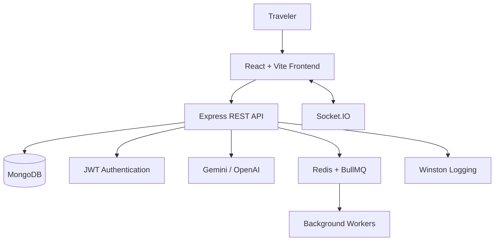

# Trippy 🌍
### Your Entire Journey. One Intelligent Platform.

**Trippy** is an AI-powered travel planning platform that brings itinerary generation, trip organization, interactive maps, and conversational travel assistance into one experience.

Instead of juggling multiple tabs to plan a trip, Trippy aims to give travelers one place to explore destinations, build personalized itineraries, and organize their journey.

<p align="center">
  <a href="https://trippy-psi-azure.vercel.app/"><strong>🚀 Live Demo</strong></a>
  &nbsp; · &nbsp;
  <a href="https://github.com/nikk1108/Trippy"><strong>📦 Source Code</strong></a>
</p>

---

## ✨ What Makes Trippy Different?

Travel planning involves more than generating a list of places. It requires organizing destinations, understanding preferences, navigating locations, and adapting plans as needs change.

Trippy combines AI-assisted planning with a full-stack application architecture to bring these workflows together.

## 🚀 Features

### 🤖 AI-Powered Itinerary Planning
- Generate travel itineraries based on user interests and preferences.
- Organize travel ideas into a structured plan.
- Use AI integrations to support personalized travel planning.

### 🧭 Travel Copilot
- A conversational interface designed for travel-related assistance.
- Supports a more interactive planning experience.
- AI-dependent functionality requires the appropriate API configuration; some functionality may operate in demo mode.

### 🗺️ Interactive Travel Exploration
- Map-based exploration powered by Leaflet.
- Visualize geographic information through an interactive interface.
- Combine destination discovery with itinerary planning.

### 🔐 Authentication & Access Control
- JWT-based authentication.
- Refresh-token support.
- Role-based access control and administrative workflows.

### ⚡ Real-Time & Background Infrastructure
- Socket.IO for real-time communication.
- Redis and BullMQ for background job processing.
- Event-driven components to support communication between application modules.

### 📱 Modern Web Experience
- Responsive React interface.
- Progressive Web App capabilities.
- Data visualizations with Recharts.
- Utility-focused UI built with Tailwind CSS and Lucide icons.

---

## 🏗️ Technology Stack

| Layer | Technologies |
|---|---|
| Frontend | React, Vite, Tailwind CSS |
| UI & Visualization | Lucide, Recharts |
| Maps | Leaflet |
| Backend | Node.js, Express.js |
| Database | MongoDB, Mongoose |
| Authentication | JWT, refresh tokens, RBAC |
| Real-time | Socket.IO |
| Background Jobs | Redis, BullMQ |
| Logging | Winston |
| AI | Gemini, OpenAI |
| Deployment | Vercel, Render |
| Containerization | Docker |

---

## 🧠 System Architecture

At a high level, Trippy separates the user interface, API layer, data persistence, and supporting services.



The diagram represents the major architectural components; it is not a claim that every integration is active in every deployment.

---

## 🛠️ Getting Started

### Prerequisites

- Node.js and npm
- MongoDB instance
- Redis, if using background-job functionality
- API credentials for whichever AI providers you enable

### Installation

Clone the repository:

```bash
git clone https://github.com/nikk1108/Trippy.git
cd Trippy
```

Inspect the repository structure to identify the frontend and backend directories. Install dependencies in each application directory:

```bash
npm install
```

If the frontend and backend have separate `package.json` files, run the command in each directory instead.

### Environment Configuration

Create the required environment files based on the project's existing configuration and example files.

Depending on the features you enable, configuration may include:

- MongoDB connection string
- JWT and refresh-token secrets
- Gemini or OpenAI API credentials
- Redis connection details
- Frontend API base URL

**Security:** Never commit API keys, database credentials, or authentication secrets.

### Run Locally

Use the scripts defined in each application's `package.json`. For example, if the relevant scripts exist:

```bash
npm run dev
```

Check the project configuration for the exact startup commands and ports.

---

## ⚙️ Engineering Highlights

Trippy explores several concepts relevant to production-oriented full-stack development:

- **Modular backend design:** Separating API responsibilities into maintainable components.
- **Authentication architecture:** Access control and token refresh workflows.
- **Asynchronous processing:** Redis-backed job queues for work that should not block request handling.
- **Real-time communication:** Socket.IO integration.
- **External service integration:** AI providers and their configuration requirements.
- **Operational visibility:** Structured application logging.
- **Containerization:** Docker-based development or deployment workflows.

---

## 🗺️ Roadmap

Potential areas for further development include:

- [ ] Complete end-to-end flight and hotel booking integrations.
- [ ] Persist and edit itineraries across sessions.
- [ ] Add itinerary collaboration and trip sharing.
- [ ] Improve AI response handling, validation, and fallback behavior.
- [ ] Add automated tests for API endpoints and critical user flows.
- [ ] Improve deployment observability and background-job monitoring.

These are future improvements, not claims about existing functionality.

---

## 🔗 Links

- **Live application:** https://trippy-psi-azure.vercel.app/
- **GitHub repository:** https://github.com/nikk1108/Trippy
- **Developer:** [Naresh Modsara](https://github.com/nikk1108)
- **LinkedIn:** https://www.linkedin.com/in/naresh-modsara-27447b3a6/

---

*Built to explore the intersection of travel, AI, and full-stack engineering.*
